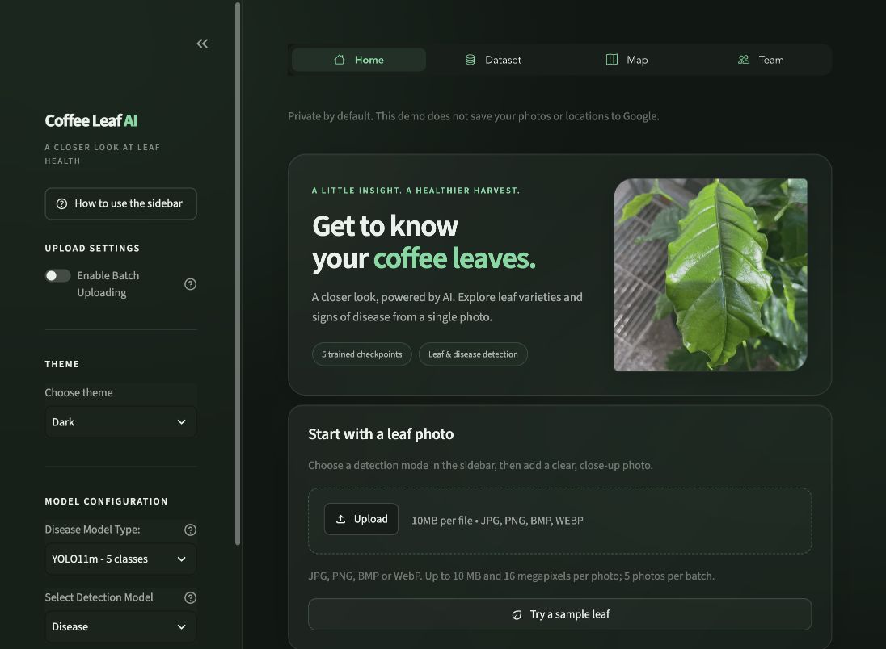
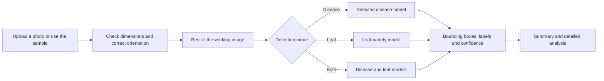

# Coffee Leaf AI

**A closer look at coffee leaf health, powered by computer vision.**

Coffee Leaf AI is a Python web app for detecting signs of disease and identifying coffee leaf varieties from photos. It brings five trained model checkpoints into one Streamlit interface: upload a leaf photo, choose a detection mode, and inspect the predicted labels, bounding boxes, and confidence scores.



[Live app](https://coffeeleafdetection.streamlit.app/) · [Quick start](#quick-start) · [Using the app](#using-the-app) · [Models](#models) · [Deployment](#deployment) · [Testing](#testing)

> This is a demonstration app. Predictions are model estimates, and confidence scores are not a measure of accuracy on new photos.

## Features

| Feature | What it does |
| --- | --- |
| Disease detection | Finds signs associated with the selected disease or pest model's labels. |
| Leaf identification | Predicts Arabica, Liberica, or Robusta leaf varieties. |
| Combined detection | Runs a disease model and the leaf-variety model on the same photo. |
| Batch uploads | Accepts up to five photos and lets you switch between their results. |
| Visual results | Shows the original and annotated images, a result summary, and detailed analysis. |
| Adjustable predictions | Exposes confidence and overlap thresholds in Advanced Options. |
| Built-in sample | Lets you try the complete detection flow without finding a photo first. |
| Leaf and disease reference | Includes descriptions, prevention information, and care suggestions in the Dataset section. |
| Glass-style interface | Uses charcoal panels, green accents, soft highlights, and Light/Dark appearance controls. |
| Optional Google storage | Retains Google Drive, Google Sheets, and map integrations for separately configured installations. |

The standard demo runs without Google credentials. Google saving and the data-backed map remain unavailable until configured.

## Quick start

### Requirements

- **Python 3.11** and Git.
- An internet connection to install dependencies.
- All five checkpoint files in [`weights/`](weights/). They are included in this repository.

Inference runs on the CPU; a GPU is not required.

### macOS or Linux

```bash
git clone https://github.com/bharathlogs/Coffee-Leaf-Disease-Detection.git
cd Coffee-Leaf-Disease-Detection

python3.11 -m venv .venv
source .venv/bin/activate

python -m pip install -r requirements.txt
python -m streamlit run app.py
```

Open the local URL printed by Streamlit, normally **http://localhost:8501**.

<details>
<summary>Windows setup with PowerShell</summary>

```powershell
git clone https://github.com/bharathlogs/Coffee-Leaf-Disease-Detection.git
cd Coffee-Leaf-Disease-Detection

py -3.11 -m venv .venv
.\.venv\Scripts\Activate.ps1

python -m pip install -r requirements.txt
python -m streamlit run app.py
```

</details>

<details>
<summary>Linux: OpenCV system libraries</summary>

If OpenCV reports missing shared libraries such as `libGL.so.1`, install the system packages listed in [`packages.txt`](packages.txt). On Debian or Ubuntu:

```bash
sudo apt-get update
sudo apt-get install -y libgl1 libglib2.0-0
```

</details>

Run commands from the repository root so that the app can find its reference data and static assets. Exact Python dependency versions are listed in [`requirements.txt`](requirements.txt); Linux installs use CPU-only PyTorch wheels.

## Using the app

1. Open **Home** and leave the defaults selected for a first run.
2. Click **Try a sample leaf**, or upload a clear photo with the coffee leaf in focus.
3. Compare **Original Image** and **Detected Image**.
4. Read the **Summary** for labels and scores, or open **Detailed Analysis** for individual detections and available photo metadata.
5. Use **Try another image** to return to uploading.

For your own photos, use good lighting and a close view of the leaf. Blurry or distant subjects can produce poor results.

### Sidebar guide

A collapsible **How to use the sidebar** guide is also available inside the app.

| Control | How to use it |
| --- | --- |
| Enable Batch Uploading | Select multiple photos, up to five. Use the pagination below the images to switch between results. |
| Choose theme | Switch between Light and Dark appearance. |
| Select Detection Model | Choose **Disease**, **Leaf**, or **Both Models**. |
| Disease Model Type | Select a disease checkpoint for Disease or Both Models. This choice does not change the model used by Leaf mode. |
| Advanced Options | Turn on the confidence and overlap sliders. Leave this off to use the defaults. |
| Model Confidence | Defaults to **60%**. Raising it shows fewer predictions; lowering it also includes lower-scoring candidates. A high score does not guarantee a correct prediction. |
| Overlap Threshold | Defaults to **30%**. Lower values remove more overlapping boxes; higher values retain more. |
| Clear Detection Cache | Clears cached results held in the current browser session. This control appears after detection. |

### Other sections

- **Dataset:** browse the app's leaf-variety and disease reference information. This page is an information library, not a downloadable training dataset.
- **Map:** view saved disease reports when the Google Sheets connection is configured. Without credentials, the page explains that the connection is unavailable.
- **Team:** Bharath and Prince.

## Models

The app includes **four disease checkpoints and one leaf-variety checkpoint**. Each disease checkpoint has its own label set; switching models can change which conditions are detectable.

| File | App selection | Model labels |
| --- | --- | --- |
| [`yolo11m96.pt`](weights/yolo11m96.pt) | YOLO11m - 5 classes | Abiotic disorder, Cercospora, healthy, rust, sooty mold |
| [`cdisease.pt`](weights/cdisease.pt) | YOLO11s - 6 classes | Algal growth, Cercospora, leaf miner, leaf rust, red spider mite, sooty mold |
| [`spots.pt`](weights/spots.pt) | YOLO12n - Spots | Abiotic disorder, Cercospora, healthy, rust, sooty mold |
| [`yolo12n.pt`](weights/yolo12n.pt) | YOLO12n - 5 classes | Abiotic disorder, Cercospora, healthy, rust, sooty mold |
| [`cleaf.pt`](weights/cleaf.pt) | Leaf / Both Models | Arabica, Liberica, Robusta |

**Disease** runs the selected disease checkpoint. **Leaf** runs `cleaf.pt`. **Both Models** runs the selected disease checkpoint alongside `cleaf.pt`; it does not combine all four disease models into an ensemble.

The interface normalizes some label spellings, including `leaf_rust` to `rust` and `sooty-mold` to `sooty mold`.

`cleaf.pt`, `spots.pt`, and `yolo12n.pt` were restored from [FTsune/kape](https://github.com/FTsune/kape) at a pinned commit. Their downloaded Git blob hashes were verified. See [`weights/SOURCES.md`](weights/SOURCES.md) for provenance, SHA-256 checksums, and third-party licensing notes. The weights were not retrained or converted for this app.

## How detection works



The app loads models on demand and caches up to two model entries. Prediction calls are synchronized to protect YOLO's shared predictor state across sessions. Original checkpoint files remain unchanged.

### Upload and memory limits

| Limit | Value |
| --- | --- |
| Supported formats | JPG, JPEG, PNG, BMP, WebP |
| Maximum upload size | 10 MB per photo |
| Maximum image dimensions | 16 megapixels per photo |
| Maximum batch | 5 photos |
| Working image resolution | Fits within 1600 × 1600 pixels, preserving aspect ratio |
| Detection-result cache | Up to 6 images per browser session |

These limits reduce memory use. They do not establish a concurrent-user capacity for a hosted instance.

## Deployment

The public demo is live at **[coffeeleafdetection.streamlit.app](https://coffeeleafdetection.streamlit.app/)** on [Streamlit Community Cloud](https://docs.streamlit.io/deploy/streamlit-community-cloud/get-started/quickstart).

To deploy your own instance:

1. Sign in at [share.streamlit.io](https://share.streamlit.io/) and connect your GitHub account.
2. Create an app from **bharathlogs/Coffee-Leaf-Disease-Detection**.
3. Choose the branch you intend to publish, normally **main**.
4. Set the main file to **app.py**.
5. Select **Python 3.11** in Advanced settings.
6. Leave secrets empty for the standard demo, then deploy.
7. After startup, try the sample photo and check Disease, Leaf, and Both Models modes, plus the Dataset, Map, and Team pages.

[`requirements.txt`](requirements.txt), [`packages.txt`](packages.txt), and [`.streamlit/config.toml`](.streamlit/config.toml) supply the Python dependencies, OpenCV system packages, upload cap, and default theme.

All five checkpoints completed sample predictions on the live demo, including Disease, Leaf, and Both Models modes. The sidebar guide, Dataset, Map fallback, and Team pages were also checked. Concurrent-user capacity and long-term uptime have not been measured.

## Optional Google integrations

The default demo does **not** need a Google account or API key. Without configured credentials:

- Drive and Sheets save buttons are disabled.
- The Map page does not query Google Sheets.
- Photo details do not send GPS coordinates to the reverse-geocoding service.

To configure an installation with Google storage:

1. Prepare your own Google service account and enable the required Drive and Sheets APIs.
2. Give that account appropriate access to your destination resources.
3. Configure the `gcp_service_account` secrets table using Streamlit's local secrets file or the hosting platform's secret settings.
4. Check `SHEET_NAME` in [`modules/database.py`](modules/database.py) and `PARENT_FOLDER_ID` in [`components/detection.py`](components/detection.py). Replace the existing destinations with your own.
5. Prepare the sheet with these headers: `Timestamp`, `Disease Detected`, `Confidence`, `Latitude`, `Longitude`, `Altitude`.
6. Verify saving, folder access, date parsing, and map visibility with your own resources before enabling the integration for other users.

This optional setup is not exercised by the default test suite. A configured installation can store photos and image metadata, including GPS coordinates when available; its Map page can display stored records.

### Credentials and privacy

Keep credentials out of Git. The local `.streamlit/secrets.toml` path is ignored by this repository. Previously exposed service-account credentials should be revoked and replaced; deleting a file from the current branch does not revoke a key or remove it from Git history.

The standard demo processes photos in application memory. This does not provide a guarantee about a hosting provider's access or logging practices.

## Project structure

```text
Coffee-Leaf-Disease-Detection/
├── app.py                       # App shell, navigation, theme and shared styles
├── components/
│   ├── config/                  # Model registry, loading and image preparation
│   ├── dataset/                 # Leaf and disease reference JSON
│   ├── detection.py             # Sidebar controls and detection page
│   ├── ui_manager.py            # Upload, result and analysis views
│   └── ...                      # Dataset, map and team pages
├── modules/                     # Inference, boxes, caching, metadata and storage
├── static/images/               # Bundled sample and reference images
├── weights/                     # Five checkpoints and provenance notes
├── tests/test_demo.py            # Inference, input and UI smoke coverage
├── docs/images/                 # README interface preview
├── .streamlit/config.toml       # Theme and server settings
├── packages.txt                 # Linux system libraries
└── requirements.txt             # Pinned Python dependencies
```

## Testing

With the virtual environment activated, run:

```bash
python -m unittest discover -s tests -v
```

The suite covers:

- Home and Map startup without Google credentials.
- Optional Drive authentication without secrets.
- Real inference with the original disease checkpoints.
- Restored checkpoints in combined mode, including the leaf model.
- Label normalization.
- Image resizing, corrupt files, and oversized image-header recovery.
- The sample-photo flow and disabled saving in the default demo.

These are functional and inference smoke tests. They do not measure accuracy, diagnose plant disease reliably, or validate Google storage against a live account.

## Troubleshooting

| Problem | Check |
| --- | --- |
| A Python module is missing | Activate `.venv` and install `requirements.txt` using that environment's Python. |
| A checkpoint is missing | Confirm all five `.pt` files listed above exist in `weights/`; run from the repository root. |
| OpenCV cannot load `libGL.so.1` | Install the system packages in `packages.txt`; see the Linux instructions above. |
| No detections appear | Use a clear, close photo, check the selected model's label set, and inspect the confidence threshold. |
| An upload is rejected | Check its format, file size, dimensions, and the five-photo batch limit. |
| The map is unavailable | This is expected without a configured Google Sheets connection. |
| Saving fails after Google setup | Verify the service account, API access, sheet headers, and destination folder permissions. |
| Hosting is slow or runs out of memory | Reduce batch size and compare the available models on the actual host. Check the platform's logs and resource limits. |

## Scope and limitations

- This repository contains an inference app and trained checkpoints, not a reproducible training pipeline or a labelled evaluation dataset.
- Results depend on the selected checkpoint, photo quality, lighting, framing, and the conditions represented in its training data.
- Confidence scores and checkpoint filenames do not establish an accuracy percentage.
- Reference care suggestions come from the bundled information library; they are not a validated treatment recommendation system.
- Google integrations and hosted load require separate validation. The app does not implement user accounts or access control for shared Google-backed records.

## Team and credits

**Bharath · Prince**

Thanks to [FTsune/kape](https://github.com/FTsune/kape) for the restored model weights. The app uses Streamlit, Ultralytics, PyTorch, OpenCV, Pillow, NumPy, pandas, and Plotly, with optional Google API clients.

## License

Application source is provided under the [MIT License](LICENSE).

Model weights, datasets, and dependencies have their own terms. Review [`weights/SOURCES.md`](weights/SOURCES.md) and the relevant upstream licenses before reusing or redistributing them.
